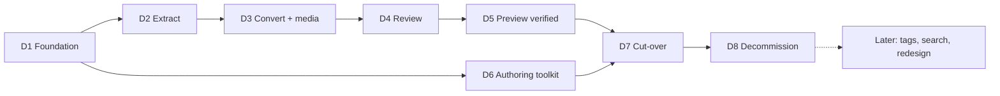

# Roadmap: blog migration to Azure Static Web Apps

Source spec: [Blog migration to Azure Static Web Apps](https://claude.ai/artifact/PmiCw6padyDe5FgAwnHcJy) (read 2026-10-17, rev 13).
Written 2026-10-17. The spec budgets one weekend for the migration proper; the deliverables below split that work, plus the authoring toolkit and the decommission tail, into pieces that each end in something you can check.

## Deliverables at a glance

| # | Deliverable | Depends on | Done when |
| --- | --- | --- | --- |
| D1 (done) | Decisions closed and foundation live | — | An empty site answers on the preview URL after a manual workflow run |
| D2 | Content extracted | D1 | 77 posts and 1 page committed as raw input (BlogML or scraped) |
| D3 | Content converted and media fetched | D2 | `check.mjs` passes on all generated posts; `report.md` lists every miss |
| D4 | Review pass accepted | D3 | Every post has a report line; you accepted the uncertain ones and the missing-image list |
| D5 | Preview verified | D4 | All legacy URLs, redirects, feed, 404 and Lighthouse checks pass on the preview URL |
| D6 | Authoring toolkit | D1 (parallel with D2 to D5) | A test article goes from "new post" to live in under 10 minutes, no manual git |
| D7 | Cut-over to vandiest.biz | D5, D6 | HTTPS serves a valid certificate on apex and www; sitemap submitted |
| D8 | Decommission | D7 + 2 weeks | App Service and plan deleted; migration tooling removed from the repo |
| Later | Optional follow-ups | D8 | Tag pages, client-side search, redesign, form service |

## D1. Decisions closed and foundation live

**Goal.** Close the five open questions from the spec and stand up the empty pipeline end to end, so everything after this lands in a working repo and deploys with one click.

**Decisions** (taken 2026-10-17):

- [x] Repository: `geobarteam/vandiest-blog`, public.
- [x] Domains: both `vandiest.biz` and `www.vandiest.biz` (the Free plan's 2 custom domains).
- [x] Contact page: `mailto` link plus LinkedIn; no form service.
- [x] Tag pages: skipped for now (stays in the Later bucket).
- [x] Look: a new design from the start, not a rebuild of SimpleBlog. The design system is [Vandiest Pixel](https://claude.ai/artifact/H3ZHNp2qXmtDq8UznQUsis) (read 2026-10-17); see "Design track" below.

**Design track.** The design system exists, so D1 translates it into the static site rather than designing anew. Vandiest Pixel is a 16-bit game look: pixel-art chrome (4px grid, hard notched borders, no radius, no blur), Pixelify Sans and Press Start 2P for headings and labels, Nunito Sans for running text, JetBrains Mono for code, two themes (Day default, Night), and eight components (Button, NavBar, Chip, StatusLine, PostCard, LevelSelect, Callout, CodeBlock) plus two pixel illustrations (hero, avatar).

What D1 derives from it:

- `css/site.css`: the colour, type, spacing, shadow tokens from `tokens.json` as custom properties on `:root`, Night under `prefers-color-scheme: dark`; the pixel-border and lift recipes; the layout rules (1200px content, 720px article measure, 320px sidebar stacking under 900px, 40px gutter).
- `templates/post.html` and the home and archive pages: markup copied from the component previews (NavBar, PostCard, Chip, CodeBlock, Callout), no React. The system's own README says to copy markup and `bundle.css` for the static site.
- The Prism theme, inside `css/site.css`, mapped to the `code-bg` and `code-*` tokens so highlighted blocks match the CodeBlock component.
- `site/img/`: the hero and avatar PNGs downloaded from the system's asset store, served with `image-rendering: pixelated`.
- Three pages built as the first acceptance of the look: home (10 latest posts as PostCards), a post page with a code block and an image, the archive by year.

Where the system and the spec disagree, resolved as follows:

| Spec says | System says | Resolution |
| --- | --- | --- |
| System fonts | Four Google Fonts families | Self-host subsetted woff2 files under `site/fonts/` with `font-display: swap`, so no third-party request and Lighthouse stays above 95. Body text keeps a system-ui fallback. |
| One stylesheet | `bundle.css` plus `tokens.css` | Still one stylesheet, `css/site.css`, written by hand from the tokens and the bundle; Prism CSS is the only second file. |
| No framework | React 18 bundle | Not shipped; markup only. |
| Readable with CSS disabled | Pixel chrome everywhere | Unchanged; the HTML conventions below win. Labels in Press Start 2P are 9 to 10px, so they are uppercase single words only and never carry content a reader needs. |
| Not mentioned | Day and Night themes | Both, via `prefers-color-scheme`; no toggle in the first version. |
| Not mentioned | Game vocabulary (Level, Cleared) | Only where it maps to real structure; the archive by year is not a level select unless a series exists. |

**Scope.**

- Create the GitHub repo and clone it; add the layout from the spec with an empty `site/`.
- Create the Static Web App (Free, West Europe, source GitHub, build preset Custom, app location `site`, output empty). Keep the deployment token as the `AZURE_STATIC_WEB_APPS_API_TOKEN` secret.
- Replace the workflow Azure commits with `.github/workflows/deploy.yml`: `workflow_dispatch` and push to `main`, `skip_app_build: true`, no `pull_request` trigger.
- `site/staticwebapp.config.json`: 301s for `/syndication.axd` (both formats) to `/rss.xml`, `/contact.aspx` to `/contact/`, `trailingSlash: auto`, custom 404, long cache on `/img/` and `/css/`.
- The three pages (home, post, archive) built from Vandiest Pixel and approved by you on the preview URL; see Design track.
- `templates/post.html` and `css/site.css` built from the design system and following the HTML conventions (HTML5, canonical, Open Graph, one JSON-LD `BlogPosting` block, `<article>` body, system fonts, readable without CSS).
- `tools/build.mjs` (index, archive, `rss.xml`, `sitemap.xml`, `search.json`, header/footer refresh) and `tools/check.mjs` (structure, metadata, escaped code, image sizes, internal links). Node 20, one dependency (`node-html-parser`), under a second.
- Prism JS hosted in the repo, its theme mapped to the code tokens inside `css/site.css`; self-hosted fonts under `site/fonts/`. `404.html`, `robots.txt`, `contact/index.html`, `page/gentsbbq/index.html` placeholder.
- `AGENTS.md` with the conventions, the voice rules and "never change a published URL".

**Done when.**

- A manual Run workflow and a push to `main` both deploy `site/` to `<name>.azurestaticapps.net` in about a minute.
- `node tools/check.mjs` and `node tools/build.mjs` run clean on a hand-written sample post.
- The feed redirect and the 404 page work on the preview URL.

**Out of scope.** Any migrated content; custom domains.

**Status (2026-10-17): done, pending your look approval.**

| Item | Value |
| --- | --- |
| Repository | https://github.com/geobarteam/vandiest-blog (public, `main`) |
| Static Web App | `swa-vandiest-blog`, Free, West Europe, resource group `rg-vandiest-blog` |
| Preview URL | https://kind-pebble-064b5f003.4.azurestaticapps.net |
| Secret | `AZURE_STATIC_WEB_APPS_API_TOKEN`, piped from Azure to GitHub without being printed |

Verified on the preview URL: push and manual runs both deploy; `/syndication.axd` (both formats) and `/contact.aspx` return 301; a post path without trailing slash returns 301 to the slashed path; a wrong path returns the custom 404 with status 404; images and fonts carry a one-year immutable cache header. `check.mjs` catches a missing tag, an inline style, a code block without language, an image without alt and a broken internal link.

Deviations from the spec, all deliberate:

- The app was created with the Azure CLI, unlinked from GitHub, instead of in the portal. Azure therefore committed no workflow file and the token-based workflow is the only one.
- CI runs Node 22, not 20. Node 20 reached end of life in April 2026; the scripts still run on 20.
- The Prism theme lives inside `css/site.css`, so the site has exactly one stylesheet.
- `tools/layout.mjs` is the single source for the header, footer and sidebar; `build.mjs` stamps them into every page and into `templates/post.html`.
- `CLAUDE.md` holds one line importing `AGENTS.md`. `evolution/` and `memory/` are git-ignored so local agent notes stay out of the public repository.
- The SWA ignores the custom content type for `/rss.xml` and serves `text/xml`, which feed readers accept.

Open before D7:

- [ ] Approve the look on the preview URL (home, the sample post, archive, Night theme).
- [ ] Give the public contact address and the LinkedIn profile URL; `site/contact/index.html` holds placeholders marked TODO.
- [ ] D3 deletes the sample post `post/2026/10/17/sample-post-style-check/` and its image.

## D2. Content extracted

**Goal.** Get all 77 posts and the one static page out of BlogEngine once, committed as repeatable raw input.

**Scope.**

- Primary path: BlogEngine admin, Settings, Export; save as `tools/migrate/blogml.xml`.
- Fallback (no login): `tools/migrate/scrape.mjs` reads `sitemap.axd`, fetches each post URL and `/page/gentsbbq` over HTTP with a 300 ms pause, saves raw pages under `tools/migrate/raw/` named by URL.
- Guard rails in the scraper: HTTP only (HTTPS serves the wrong certificate), at most three requests a second, never follow `/?tag=` or `/category/` listing pages.

**Done when.**

- 77 post entries and 1 page are present in the raw input, with raw HTML bodies, categories, tags and dates.
- The raw input is committed once so conversion can be re-run from scratch.

**Risk watched.** Admin export fails on the old build. The scraper was already tested read-only on 2026-10-17: all 77 pages answer 200 over HTTP.

## D3. Content converted and media fetched

**Goal.** Turn the raw input into convention-conforming pages with all media hosted in the repo, with a report of everything that could not be resolved. No article is migrated by hand.

**Scope.**

- `tools/migrate/convert.mjs`: one `site/post/yyyy/mm/dd/slug/index.html` per post; title, date, tags, body from BlogML (or the scraped selectors `h2.post-title`, URL, `div.post-tags`, `div.post-body`). Rewrites `/image.axd?picture=...` to `/img/yyyy/slug-nn.png`, makes internal links root-relative, drops `#comment` anchors and share widgets.
- Live Writer code-block collapse: runs of styled `<pre>` siblings become one `<pre><code class="language-...">`, text unescaped then re-escaped. Only consecutive `<pre>` siblings merge. This is the largest clean-up (about 1,400 blocks).
- `tools/migrate/media.mjs`: downloads the 70 distinct `image.axd` pictures and 2 `file.axd` attachments into `site/img/yyyy/` and `site/files/`. For the 31 skynet, 5 old-subdomain and 2 blogspot images, asks the Wayback Machine for the closest capture. Downloads the 21 images already on `web.archive.org` too. Resizes anything over 300 KB to 1200 px wide.
- `tools/migrate/report.md`: posts converted, code blocks merged, images found and missing, off-site links.
- The `migrate-post` skill wraps the same single-post logic for manual re-runs.

**Done when.**

- 77 posts and the static page are generated; `node tools/check.mjs` passes on the whole `site/`.
- `node tools/build.mjs` produces index, archive, feed, sitemap and `search.json`; the site opens locally (Live Server or `npx serve site`).
- The report lists every missing image and every unguessed code language, with no silent drops.

**Risk watched.** A styled line that is prose, not code, merged into a code block. Mitigation lives in D4: the review diffs text content before and after.

## D4. Review pass accepted

**Goal.** Bring every converted post to a state you trust, with the agent doing the comparison and you spot-checking what it marks uncertain.

**Scope.**

- `.claude/agents/migrate-review.md`: compares each converted page with its raw original, fixes what the report flags (unknown code language, image to replace from Wayback or drop with a one-line note, dead outbound link to point at an archive copy), writes one report line per post with a confidence mark. Runs in batches of 10. Tools: Read, Edit, Grep, Bash (node only), WebFetch for the Wayback Machine.
- `.claude/agents/link-checker.md`: crawls `site/`, checks every internal link, image and the 77 legacy URLs, reports broken ones with file and line.
- Your pass: read the report, open the posts marked uncertain (expect 10 to 15, mostly from 2010), accept or correct. No XHTML edited by hand.

**Done when.**

- Every one of the 77 posts has a report line and a confidence mark.
- Zero broken internal links and images from the link-checker.
- You have accepted the missing-image list (text kept, one-line note where the picture was).
- Every code block is a single `<pre><code>` with a language class and Prism highlights it.

## D5. Preview verified

**Goal.** Prove on the preview URL that nothing is lost for search before any DNS changes.

**Scope.**

- Push `main`; the Actions run uploads `site/`.
- Run `check.mjs` and the link-checker against `<name>.azurestaticapps.net`.
- Run Lighthouse on a post page (mobile).

**Done when** (the automated half of the acceptance checklist):

- All 77 legacy post URLs answer 200 at the same path, with and without trailing slash.
- Every post has title, description, canonical, JSON-LD and at least one tag.
- `/syndication.axd` and `/syndication.axd?format=atom` return 301 to `/rss.xml`; the feed validates and holds the 20 latest posts in full.
- `/sitemap.xml` lists 77 posts and 2 pages; `robots.txt` points at it.
- A wrong URL returns the custom 404 page with status 404.
- Home shows the 10 latest posts, archive shows all by year, both regenerate on `build.mjs`.
- Lighthouse performance and accessibility above 95 on mobile.

## D6. Authoring toolkit (runs in parallel with D2 to D5)

**Goal.** Make "new article = one folder, one script run, one commit, one click" true, with the agent unable to push on its own.

**Scope.** Everything lives under `.claude/` in the blog repo.

Skills (`.claude/skills/<name>/SKILL.md`):

| Skill | Trigger | Does |
| --- | --- | --- |
| new-post | "new post: <title>" | Creates the post folder from the template, fills title, date, canonical, empty JSON-LD; refuses an existing slug |
| publish-post | "publish", "put it online" | Runs check and build, shows the diff and the feed entry, asks for your go, commits and pushes; never pushes without the go |
| edit-post | "fix the typo in...", "update the post about..." | Finds the post, edits, bumps `dateModified`, rebuilds; never changes a published URL |
| optimise-images | image dropped into `site/img/` | Resizes to 1200 px max, WebP when smaller, writes width, height and a proposed alt |
| code-block | pasting code | Escapes, wraps in `<pre><code class="language-...">`, detects language, trims |
| draft-from-notes | "write a post from these notes" | Drafts in your voice into a new post file for you to rewrite |
| site-status | "is the site ok?" | Fetches home, feed, sitemap, latest post; checks HTTPS and redirects; five-line report |

Agents (`.claude/agents/<name>.md`): `copy-editor` (read only, fixes and three structure suggestions, never rewrites the voice) and `seo-check` (title length, description, headings, alt texts, JSON-LD validity, related internal links by tag). `migrate-review` and `link-checker` are delivered in D4.

Hooks and settings (`.claude/settings.json`):

- PreToolUse on `Bash(git push*)`: blocked unless `publish-post` set a marker file for this run.
- PostToolUse on Edit under `site/post/`: runs `node tools/check.mjs <file>` and reports failures at once.
- Permissions: allow `node tools/*`, `git status|diff|add|commit`, `gh run list`; deny `az *` and writes to `.github/` and `staticwebapp.config.json` without a prompt.
- Pre-commit runs check and build so a broken post cannot be committed.

**Done when.**

- A test article goes from "new post" to live on the preview URL through the skills in under 10 minutes without you touching git by hand.
- An attempted `git push` outside `publish-post` is blocked by the hook.
- Drafts wait as unpushed commits or on a `draft/<slug>` branch and nothing deploys.

**Out of scope.** Posting to LinkedIn or X; that stays on Central with its approval flow.

## D7. Cut-over to vandiest.biz

**Goal.** Point the domain at the Static Web App and get valid HTTPS for the first time in a year, leaving the App Service untouched as a fallback.

**Scope.**

- In the portal add custom domains `vandiest.biz` and `www.vandiest.biz`.
- Add the TXT validation record at the registrar; switch the apex ALIAS/ANAME (or TXT-validated A record) and the `www` CNAME to the app.
- Wait for the managed certificate (within the hour).
- Submit `sitemap.xml` in Google Search Console.
- Change nothing on the App Service.

**Done when.**

- `https://vandiest.biz` and `https://www.vandiest.biz` serve a valid certificate; HTTP redirects to HTTPS.
- All 77 legacy URLs answer 200 on `vandiest.biz`; the feed redirect works on the live domain.
- `site-status` reports green.

## D8. Decommission

**Goal.** Remove the old hosting and the migration tooling once search has settled.

**Scope.**

- Check Search Console for crawl and coverage errors a few days after cut-over and again a week later.
- After two clean weeks: delete the App Service and its plan (the BlogEngine database and `App_Data` go with it).
- Keep `tools/migrate/blogml.xml` in the repo as the archive; remove `tools/migrate/raw/` and the rest of `tools/migrate/`.
- Schedule the link-checker monthly.

**Done when.**

- No coverage errors in Search Console after one week.
- App Service and plan deleted; the repo holds only `site/`, `templates/`, `tools/build.mjs`, `tools/check.mjs`, `.github/`, `.claude/`, `AGENTS.md` and the BlogML archive.

## Later. Optional follow-ups

Not needed for the migration; each is a separate small deliverable if wanted.

- Tag pages `/tag/<name>/` generated by `build.mjs` (55 tags).
- Client-side search: `search.json` is already produced; add the 40-line script.
- Contact form via a Formspree-style service if `mailto` proves insufficient.
- Switching to a generator remains possible later because the HTML is clean.

## Risks carried across deliverables

| Risk | Where it bites | Mitigation |
| --- | --- | --- |
| 38 images on dead hosts have no Wayback capture | D3, D4 | Report lists them; text kept with a one-line note; mostly 2008 to 2011 posts |
| Live Writer prose merged into code blocks | D3, D4 | Merge only consecutive `<pre>` siblings; review diffs text content before and after |
| Search ranking drops | D5, D7, D8 | Same URLs, feed 301, sitemap, canonical tags |
| Free plan limits (250 MB, 100 GB/month, 2 domains) | D3, D7 | Site under 60 MB with images; apex plus www are the 2 domains |
| Deployment token leak | D1 | Lives only in the GitHub secret; rotate from the portal; upload-only |
| Agent pushes a half-written draft | D6 | Push hook plus the skill's go step |
| BlogEngine export fails | D2 | Scraper fallback already verified |
